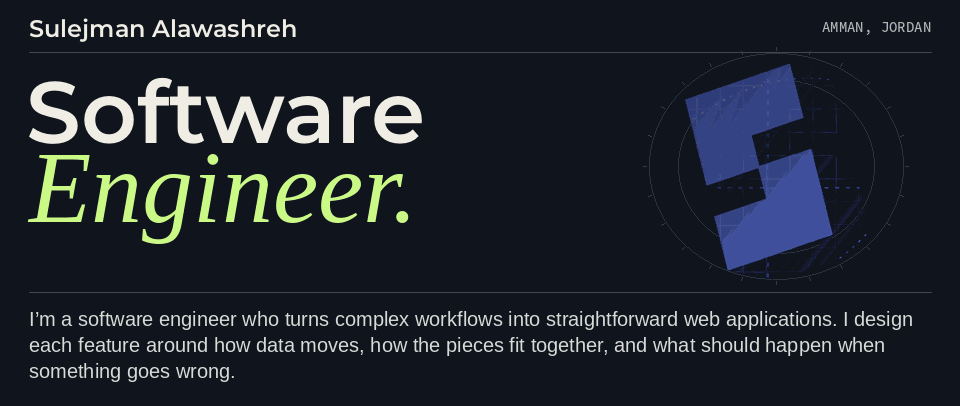

<a name="overview"></a>

<picture>
  <source media="(max-width: 600px)" srcset="assets/sulejman-mobile.gif">
  
</picture>

<p>
<a href="mailto:hello@sulejman.dev"></a>
<a href="https://www.linkedin.com/in/sulejmandev/"></a>
<a href="https://github.com/sulejmandev/portfolio"></a>
</p>

<picture>
  <source media="(max-width: 600px)" srcset="assets/stack-mobile.svg">
  
</picture>

<a name="daily-challenge"></a>

<!-- daily-backend:start -->

<picture>
  <source media="(max-width: 600px)" srcset="assets/daily-mobile.svg">
  
</picture>

<details>
<summary>Read or copy the function</summary>

Only job 2 is ready. Which IDs does this return?

```javascript
function readyJobs(ids) {
  return ids.filter(async id => id === 2);
}
console.log(readyJobs([1, 2]).join(","));
```

</details>

<details>
<summary><strong>Reveal the answer</strong></summary>

<p>Output: <code>1,2</code></p>
<p>filter checks the callback result immediately. Both promises are truthy, even the one that resolves to false. Await the readiness checks before filtering.</p>

</details>

<!-- daily-backend:end -->

<p align="right"><a href="#overview">Back to top ↑</a></p>
