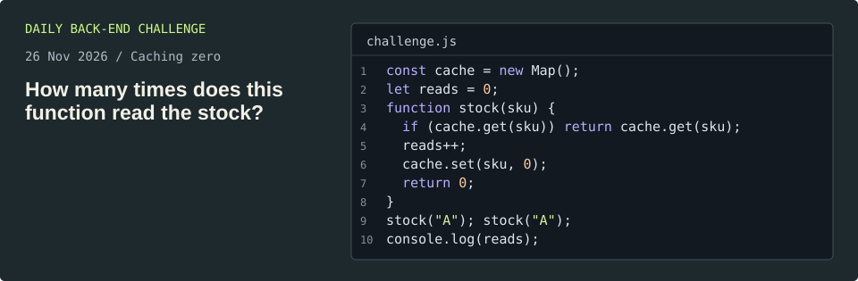

<a name="overview"></a>

<picture>
  <source media="(max-width: 600px)" srcset="assets/sulejman-mobile.gif">
  
</picture>

<p>
<a href="mailto:hello@sulejman.dev"></a>
<a href="https://www.linkedin.com/in/sulejmandev/"></a>
<a href="https://github.com/sulejmandev/portfolio"></a>
</p>

<picture>
  <source media="(max-width: 600px)" srcset="assets/stack-mobile.svg">
  
</picture>

<a name="daily-challenge"></a>

<!-- daily-backend:start -->

<picture>
  <source media="(max-width: 600px)" srcset="assets/daily-mobile.svg">
  
</picture>

<details>
<summary>Read or copy the function</summary>

With a retry limit of zero, what does this function return?

```javascript
function retryLimit(value) {
  return value || 3;
}
console.log(retryLimit(0));
```

</details>

<details>
<summary><strong>Reveal the answer</strong></summary>

<p>Output: <code>3</code></p>
<p>The || operator replaces zero with the default. Use value ?? 3 when zero means no retries.</p>

</details>

<!-- daily-backend:end -->

<p align="right"><a href="#overview">Back to top ↑</a></p>
